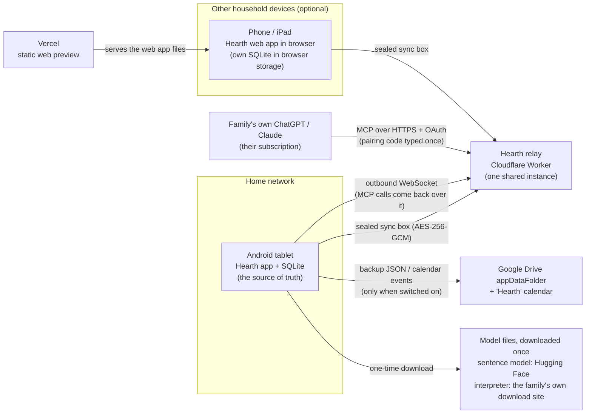
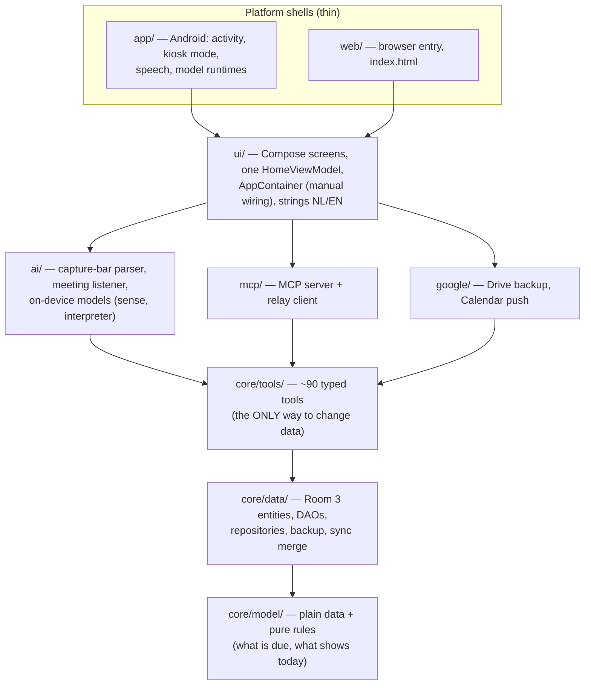
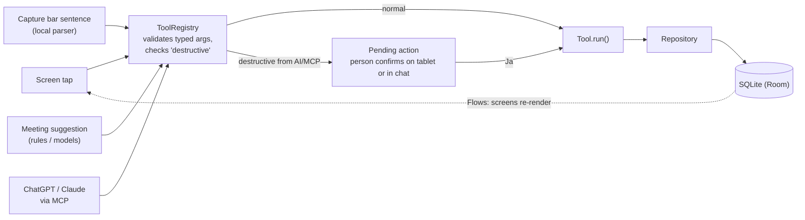
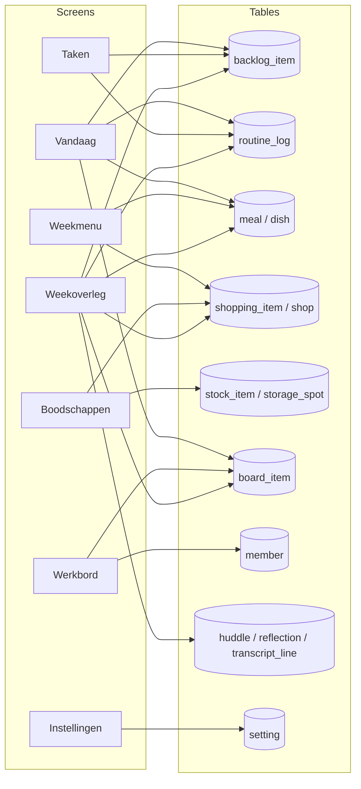
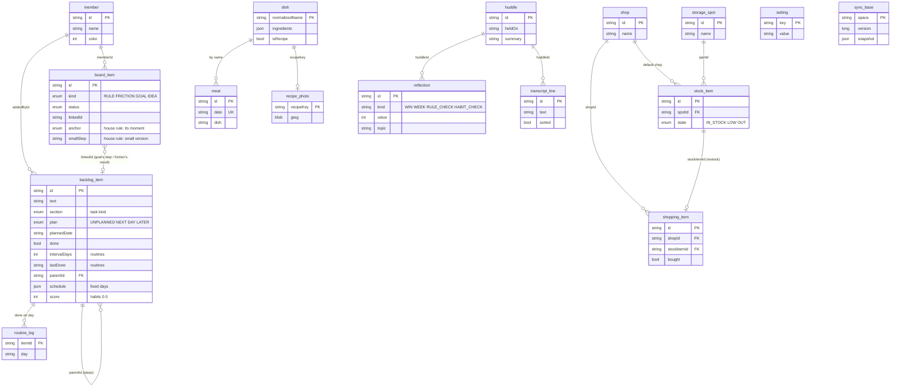
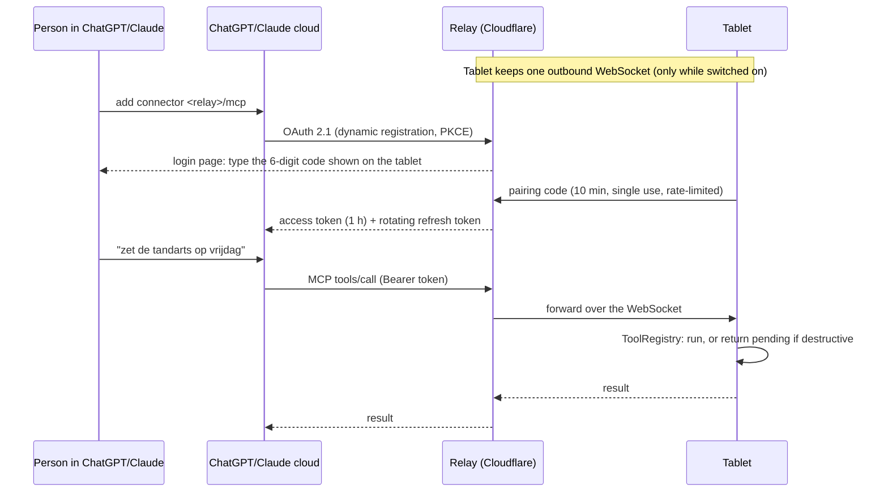
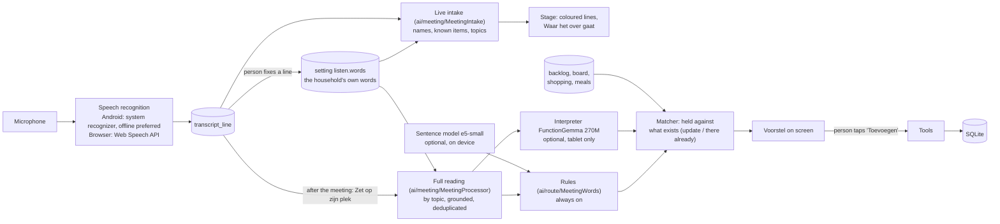

# Hearth: architecture for IT review

This page explains how Hearth is built and where data goes, for someone who reviews it without reading the code or
learning the household vocabulary. The product terms (Dutch UI words such as *Werkbord* or *Weekoverleg*) are
translated once in the table below and then used sparingly. Deeper design notes live in `PROPOSAL.md` (tools, schema
history, decisions) and `JOURNEYS.md` (user journeys).

## 1. In one paragraph

Hearth is a household organiser that runs on one shared Android tablet in the kitchen. **The tablet is the server**:
all data sits in a SQLite database on the device, and the app works fully offline. Everything outside the tablet is
optional and off by default: a family's own ChatGPT/Claude can reach the app through a small relay, Google Drive and
Calendar can be switched on for backups and a calendar, other devices can join through end-to-end encrypted sync, and
two small language models can be downloaded to run *on the tablet itself*. There is no Hearth backend that stores
household data, no accounts, no analytics.

## 2. System context: what talks to what

Key points for review:

- The tablet never accepts inbound connections. It opens one outbound WebSocket to the relay, and only while the AI
  link is switched on.
- The relay stores **no household content**: for the AI link it forwards calls; for sync it stores one encrypted blob
  per household that it cannot decrypt.
- Google access uses the two narrowest scopes that do the job (`drive.appdata`, `calendar.app.created`) and is
  requested only when someone turns the feature on.

## 3. Words you will see (just enough to read the rest)

| UI word (Dutch) | What it is | Stored in |
|---|---|---|
| Vandaag | Today's dashboard: what's planned, routines due, meals | reads many tables |
| Taken | All open tasks, grouped by topic | `backlog_item` |
| Weekmenu / Recept | Meal per day / saved dishes | `meal`, `dish`, `recipe_photo` |
| Boodschappen / Voorraad | Shopping list / what's in stock at home | `shopping_item`, `shop`, `stock_item`, `storage_spot` |
| Werkbord | Board of house rules, frictions, ideas, goals | `board_item` |
| Weekoverleg | The weekly family meeting screen (review, plan, listen along) | `huddle`, `reflection`, `transcript_line` |
| Ritmes & routines | Recurring routines and habits | `backlog_item` (routine sections) + `routine_log` |
| Instellingen / Koppelingen | Settings / connections (AI, Google, sync) | `setting` |
| Luister mee | Live transcription of the meeting (topics only); read as a whole afterwards into suggestions | `transcript_line`, `setting` (`listen.words`) |

## 4. Software layers

Kotlin Multiplatform: one shared codebase, compiled for Android (the tablet), the JVM (tests) and WebAssembly (the
browser version). Platform folders only hold glue: kiosk mode, microphone/speech, opening the database, running models.

### The one rule that makes the app reviewable: every write goes through a tool

- A tool is a class with typed arguments; its JSON Schema (for MCP) is generated from that class, so there is one
  definition per action.
- Screens and ViewModels never write to the database directly. Reads for display use repository `Flow`s.
- Tools flagged `destructive` (delete, clear, restore a backup, join another household's sync) never run straight
  from the AI: they return a pending action that a person confirms. In the UI they show a confirm dialog.
- Tools flagged `exposeOverMcp = false` (device settings, Google, sync keys, model switches) are tablet-only.
- To review what the AI can do: `core/tools/.../HearthTools.kt` lists every tool; MCP sees exactly those with
  `exposeOverMcp = true`.

## 5. Screens and the data behind them

Each screen is a view over the same tables; several screens show the same row in different places (a routine shows
on Vandaag, in Taken and in the Weekoverleg). The selection logic ("what is due today", "what goes in the meeting")
lives in `core/model` as pure functions, so screens, tools and MCP agree.

| Screen | Logic in brief | Main code |
|---|---|---|
| Vandaag | Today's plan, routines that are due, meal, then one card per topic | `TodayScreen.kt`, `core/model/Overview.kt` |
| Taken | Every open task by topic; unsorted ones on top; plan a day with `PlanSheet` | `TasksScreen.kt`, `PlanSheet.kt` |
| Weekmenu | One meal per day; planning a dish puts missing ingredients on the list | `MenuScreen.kt`, `week/WeekTools.kt` |
| Boodschappen | List per shop; marking stock "out" adds it, "bought" puts it back in stock | `ShoppingScreen.kt`, `food/*Tools.kt` |
| Werkbord | House rules, frictions, ideas, goals in columns; frictions are resolved into a rule/routine/task | `BoardScreen.kt`, `board/BoardTools.kt` |
| Weekoverleg | Ten topic tiles, look back (scores 0–5, wins), plan the week, listen along | `WeekScreen.kt`, `WeekTopics.kt`, `MeetingUi.kt` |
| Instellingen | Language, multi-device sync, AI link, Google, on-device models | `ConnectScreen.kt`, `SyncCard.kt` |
| Capture bar (every screen) | Type or speak a sentence; parsed locally into a tool call | `CaptureBar.kt`, `ai/route/*` |

## 6. Data model

All IDs are UUID strings; every row has `createdAt` / `updatedAt` (epoch ms) so backup, restore and sync can merge
safely. Schema version 20; Room auto-migrations keep every household's data.

One design choice simplifies a lot: **almost everything that needs doing is one table, `backlog_item`**. Its `section`
column decides what kind of thing it is (task, appointment, admin, project, chore, routine, habit, free time), and
optional columns are used per kind. Projects and routines have steps via `parentId`.

The two links that drive most behaviour:

1. **Restock loop:** stock item set to LOW/OUT → one linked shopping item; that item ticked "bought" → stock item back
   to IN_STOCK.
2. **Routine loop:** a routine ticked → a `routine_log` row and `lastDone` updated; the routine comes back when its
   interval or fixed day arrives (it is never "late").

`setting` holds both household settings (they sync) and device-only settings (`SettingsRepository.DEVICE_ONLY`:
relay link, sync keys, model switches), which never leave the device in a backup or sync.

## 7. Flows worth reviewing

### 7.1 The family's AI (MCP through the relay)

The relay keeps per household: a hash of the tablet key, linked apps and token hashes. No content is stored. Unlinking
an app on the tablet revokes it. Code: `relay/src/worker.js`, `mcp/`.

### 7.2 Sync between devices

Like git with a remote: each device pulls, merges three-way against the last agreed snapshot (`sync_base`), and
pushes. The snapshot is encrypted on the device (AES-256-GCM) with a household key the relay never sees. A new device
joins with a one-time 8-letter code (PBKDF2-derived key, 10 minutes, single use). Code: `core/data/sync`,
`mcp/RelaySync.kt`, `SyncTools.kt`.

### 7.3 Backup and calendar (Google, opt-in)

- Backup: the full household JSON (same format as sync, **not separately encrypted**; protected by the user's Google
  account) into Drive's hidden app folder, about daily. Restoring asks first.
- Calendar: planned items are pushed one way into a calendar Hearth creates itself; Hearth cannot read other calendars.

### 7.4 Listening to the weekly meeting (and the on-device models)

- Nothing is written from listening alone: suggestions appear on screen and a person confirms them.
- While the meeting goes on only the light intake runs (word lists, no model), so the tablet's CPU stays with the
  speech recognizer; the models run once, after the meeting, when someone taps *Zet op zijn plek*.
- Words the family puts right are kept as a household setting (`listen.words`): they travel with sync and backup like
  other household data and are handed to the recognizer as hints.
- The transcript is deleted when the next meeting ends; the meeting summary is kept.
- Speech recognition is the platform's own: Android's recognizer is asked to prefer offline (with no offline language
  pack, Android may use Google's online service); Chrome's Web Speech API sends audio to Google. This is the one place
  where spoken content can leave the device without a Hearth setting, and is worth noting in a privacy review.
- The two models (≈ 130 MB and ≈ 270 MB) are downloaded once and run with ONNX Runtime on the device. No text is sent
  anywhere to run them. Switching off deletes the files. The sentence model comes from Hugging Face when someone
  switches it on. The interpreter comes from the household's own download site (next to `hearth.apk`; the build copies
  it there from the `interpreter-model` branch), in the background and on by default on a tablet: it reads
  `manifest.json`, joins the parts (each under 100 MB) and checks every file's SHA-256 before using it; a newer version
  on the site replaces it by itself.

## 8. Review checklist

| Topic | Where it stands | Where to look |
|---|---|---|
| Data at rest | SQLite in app-private storage (tablet) / OPFS (browser); not encrypted beyond the OS | `core/data` |
| Data leaving the device | Only with a feature switched on: relay (AI calls, sealed sync), Google (backup, calendar), model download; speech per platform (7.4) | sections 2 and 7 |
| Inbound network | None on the tablet | `mcp/RelayClient.kt` |
| Authentication | AI: OAuth 2.1 + pairing code; sync: household token + device-held key; Google: OS sign-in, narrow scopes | `relay/`, `google/` |
| Secrets | Tablet key, sync keys in `setting` (device-only, never synced or backed up); no API keys in the app | `SettingsData.kt` |
| Destructive actions | Always a confirmation; AI/MCP can never delete directly | `ToolRegistry.kt`, `Tool.kt` |
| Permissions (Android) | `INTERNET`, `RECORD_AUDIO` | `app/src/main/AndroidManifest.xml` |
| Telemetry | None | — |
| Third-party code | Room, Ktor, kotlinx, Compose, ONNX Runtime; models under their own licences (FunctionGemma: Gemma Terms of Use) | `gradle/libs.versions.toml`, `docs/licenses` |
| Tests | Every tool has a unit test (in-memory DB); relay tested in workerd and end to end | `./gradlew hearthCheck` |

## 9. Build and deploy

- `./gradlew hearthCheck`: all tests (JVM + WebAssembly), Android build and lint, web bundle.
- Web preview: pushing to `hearth-household-assistant` runs the *Web preview* workflow, which deploys static files to
  Vercel. The relay deploys from the same branch when `relay/` changes (*Deploy relay*).
- Build-time addresses (no secrets): `hearth.relayUrl` (the relay), `hearth.interpreterUrl` (where the interpreter
  model is hosted; empty hides that option). CI sets the latter to `<site>/interpreter`: the Vercel production address
  (`hearth-web` is the production branch, public under Standard Protection), or the repository variable
  `HEARTH_SITE_URL`. The tablet downloads the model without logging in.
